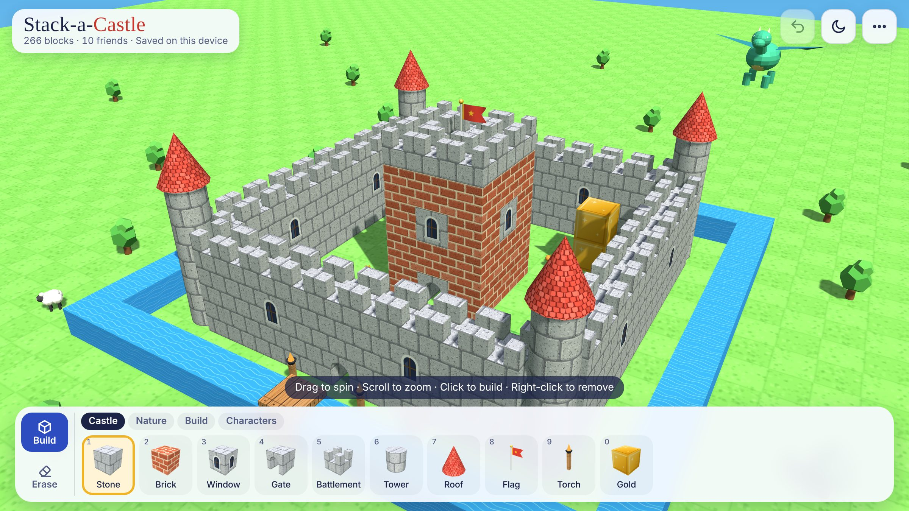

# Stack-a-Castle

A 3D castle builder that runs in any web browser, on phones and computers. Stack stone walls, towers, gates and moats on a floating island, add characters who walk around on their own, and switch between day and night.

**Play it:** https://leirocky.github.io/stack-a-castle/



## How to play

| | Phone or tablet | Computer |
|---|---|---|
| Spin the view | Drag with one finger | Drag with the left mouse button |
| Zoom | Pinch | Scroll wheel |
| Move around the island | Drag with two fingers | Drag with the right mouse button |
| Place a piece | Pick it in the tray, then tap the ground or the side of a block | Same, with a click |
| Remove a piece | Switch to **Erase**, then tap it | Right-click it (or press **E** for Erase) |
| Undo | Undo button (top right) | Undo button or **Ctrl/Cmd + Z** |
| Day / night | Moon button | Moon button or **N** |
| Pick a piece by number | — | **1–9, 0** pick the pieces in the open tab |

More options are in the **⋯** menu: build the sample castle, reset the view, auto-spin, sound on/off, save to a file, open a saved file, and clear everything.

## What's in the game

- **Castle (10):** stone, brick, window, gate, battlement, round tower, roof, flag, torch, gold
- **Nature (11):** grass, dirt, sand, cobblestone, water, tree, log, leaves, snow, ice, lava
- **Build (14):** wood, glass, slab, stairs, fence, door, lamp, lantern, and six colors
- **Characters (6):** knight, queen, sheep, chicken, cat, dragon. They wander, walk through gates and doors, climb one block at a time, and avoid water and lava. The dragon circles in the sky. Tap a character to make it jump and make its sound.
- A 100 × 100 island, blocks up to 32 high, up to 40 characters.
- Gates, doors, fences and stairs turn to face you when placed.
- At night, windows, lamps, lanterns, torches and lava glow.

All textures, models and sounds are generated in code; the game has no image or audio files. The characters are original designs.

## Saving

| Where | Status | What it does |
|---|---|---|
| This browser | ✅ Working | Every change is saved instantly on the device. Reopen the page to pick up where you left off. Clearing the browser's site data erases it. |
| A file | ✅ Working | **⋯ → Save to a file** downloads a `.json` backup. **⋯ → Open a saved file** loads it on any device. |
| Online, across devices | 🔜 Planned | Google sign-in with Firebase. See [docs/FIREBASE_SETUP.md](docs/FIREBASE_SETUP.md). |

## Run it on your computer

No build step and no install. From the project folder:

```bash
python3 -m http.server 8000
```

Then open http://localhost:8000. (Opening `index.html` directly also works in most browsers.)

## Deploying

The site is served by **GitHub Pages** from the `main` branch, root folder. Pushing to `main` updates the live site within about a minute.

## Project layout

```
index.html            Page markup: the 3D stage, top bar, menu, and the tool dock
css/style.css         All styles (colors are tokens at the top)
js/game.js            The whole game: textures, pieces, characters, controls, saving
docs/PROGRESS.md      Current status, what's done, what's next, known issues
docs/ARCHITECTURE.md  How the code works and the save-file format
docs/FIREBASE_SETUP.md  Steps to turn on online saving
.nojekyll             Tells GitHub Pages to serve files as-is
```

The game uses [Three.js](https://threejs.org/) r128, loaded from the jsDelivr CDN, plus Google Fonts (Pirata One and Fredoka).

## Status

See **[docs/PROGRESS.md](docs/PROGRESS.md)** for what's done, what's in progress and what's planned.
